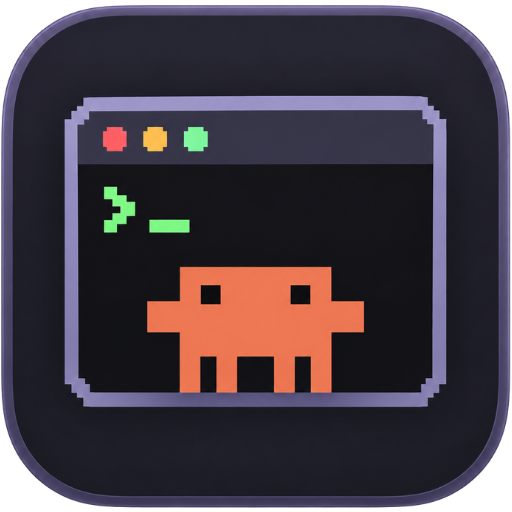
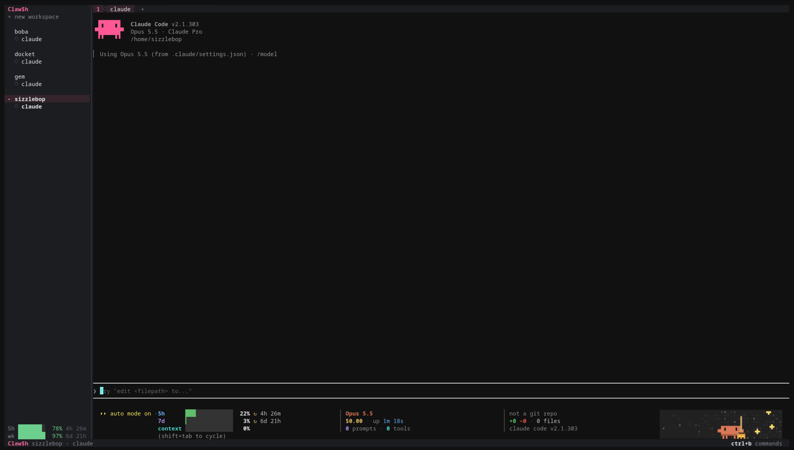

<p align="center">
  
</p>

# Claw$h

Claw$h is a terminal workspace for Claude Code. Each tab runs a real `claude` process, and Claw$h wraps it in a ratatui interface with room for workspaces, tabs, and status, all built around Claude.

I mostly use Claude, so the goal is to keep everything Claude already does (including mods and their kitty graphics) working exactly as it does in a normal terminal, and add the small things around it that I like having: per-workspace status, usage limits, and quick switching.

The command is `clawsh` (the `$` only lives in the name, since shells would read `$h` as a variable). On crates.io the package is `clawsh-tui`.

<p align="center">
  
</p>

## Features

- **Workspaces and tabs.** One workspace per folder, as many Claude tabs as you want in each, and a sidebar and tab bar you can click.
- **[Tab status](#tab-status).** See which tab is working, waiting on you, done, or failed, with desktop notifications for the ones you aren't looking at and a radar that lists every tab at once.
- **[Usage limits](#usage-limits).** Your Claude 5-hour and weekly windows at the bottom of the sidebar.
- **[Sessions that come back](#picking-up-where-you-left-off).** Workspaces, tabs, and conversations reopen on the next launch.
- **[Conversation search](#finding-an-old-conversation).** Search every saved Claude conversation across all your projects and resume the one you want.
- **[Review view](#reviewing-changes).** Look over what Claude changed (everything uncommitted, or just the last turn), comment on lines, and send the comments back.
- **[Workspace templates](#workspace-templates)** and **[prompt snippets](#prompt-snippets)** for the setups and prompts you repeat.
- **[Terminal drawer](#terminal-drawer).** A shell under (or beside) each tab for your dev server and quick commands.
- **[Copy mode](#copying-from-claude)** with scrollback, and Claude's own copies reach your real clipboard.
- **Images.** Kitty graphics from Claude and its mods show up in kitty and Ghostty, animated ones included.
- **[Light and dark](#light-and-dark-terminals).** Claw$h and Claude both follow your terminal's theme.

## Status

Claw$h is at 1.0, which for me means it's what I actually use for my Claude work every day, and the pieces in this README all work. It's still a one-person project, so there are probably rough edges I haven't hit yet. If you find one, please [open an issue](https://github.com/pinkpixel-dev/clawsh/issues).

It's Linux only. I haven't tried macOS, and Windows won't work. Images need kitty or Ghostty as your terminal.

## Requirements

- Linux (x86_64 or aarch64). I haven't tried macOS, and Windows won't work.
- [Claude Code](https://docs.anthropic.com/en/docs/claude-code) installed and logged in, with `claude` on your `PATH`
- kitty or Ghostty as your terminal if you want images from Claude mods. Everything else works in any terminal.
- `git` for the review view, and `notify-send` for desktop notifications. Both are optional; without them those two features just don't do anything.

## Installing

Each release on GitHub comes with prebuilt Linux binaries for x86_64 and aarch64, so you don't need Rust or Zig installed. They're built on Ubuntu 22.04, so any distro with glibc 2.35 or newer should be fine.

The quickest way is [cargo-binstall](https://github.com/cargo-bins/cargo-binstall), which grabs the right binary for your machine:

```bash
cargo binstall clawsh-tui
```

Or download it yourself from the [releases page](https://github.com/pinkpixel-dev/clawsh/releases). Each tarball has a `.sha256` file next to it:

```bash
tar xzf clawsh-x86_64-unknown-linux-gnu.tar.gz
install -Dm755 clawsh-x86_64-unknown-linux-gnu/clawsh ~/.local/bin/clawsh
```

You can also install from crates.io with `cargo install clawsh-tui`, but that compiles Ghostty from source, so you'll need the Zig setup described in [Building from source](#building-from-source) first.

### Building from source

The terminal emulation comes from [libghostty-vt](https://docs.rs/libghostty-vt), which builds Ghostty from source with Zig. Ghostty needs **Zig 0.15.x** exactly, and newer Zig releases (like the 0.16 in Arch's repos) fail its version check.

1. Download Zig 0.15.2 from [ziglang.org/download](https://ziglang.org/download/) and extract it to `~/.local/share/zig-0.15.2`.
2. Build through the wrapper script, which puts that Zig first on `PATH`:

```bash
./scripts/cargo.sh build --release
```

If your Zig lives somewhere else, point the script at it:

```bash
CLAWSH_ZIG_DIR=/path/to/zig-0.15.2 ./scripts/cargo.sh build --release
```

The first build clones Ghostty into the build directory, so it needs network access and takes a minute.

## Getting started

Run it from the folder you want Claude to work in:

```bash
clawsh
```

If you built from source and didn't copy the binary anywhere, it's `./target/release/clawsh` instead.

That folder becomes your active workspace. Anything after `clawsh` is passed to Claude in that folder, so `clawsh --resume` works like `claude --resume`.

### Keys

Everything is behind a `ctrl+b` prefix, so Claude still gets all its own shortcuts:

| `ctrl+b` then | What it does |
|---|---|
| `space` | Command palette: commands, tabs, workspaces, snippets, and templates |
| `c` | New Claude tab in the current workspace |
| `w` | Open a workspace (folder picker) |
| `x` | Close the current tab |
| `n` / `p` or `→` / `←` | Next / previous tab |
| `1` to `9` | Jump to a tab |
| `j` / `k` or `↓` / `↑` | Next / previous workspace |
| `s` | Hide or show the sidebar |
| `m` | Turn desktop notifications off or back on |
| `a` | Sort the sidebar by activity, or back to open order |
| `[` | Copy mode: select text with the keyboard, including the scrollback |
| `r` | Review what changed in this tab's folder and comment on it |
| `v` | Radar: every tab in every workspace, whatever needs you first |
| `/` | Search every saved conversation and resume one |
| `g` | Git worktrees: open one, make one on a new branch, or remove one |
| `,` | Rename the current tab |
| `t` | Open a workspace template |
| `T` | Save the current workspace as a template |
| `i` | Insert a prompt snippet into the current tab |
| `f` | Insert an `@` mention of a file in this workspace |
| `o` | Open the menu |
| `e` | Show or hide this tab's terminal drawer |
| `;` | Move the keyboard between Claude and the drawer |
| `q` | Quit |
| `ctrl+b` | Send a literal `ctrl+b` to Claude |
| `esc` | Cancel |

### Picking up where you left off

Claw$h remembers your workspaces, their tabs, and which conversation each tab was in. Next time you start it, everything comes back, and each tab reopens its conversation with `claude --resume`. A tab that never got a prompt just starts a fresh Claude, since there's nothing to resume yet. Folders that have been deleted are skipped, and the folder you launched from is added if it wasn't already open.

### Finding an old conversation

Press `ctrl+b` then `/` to search every conversation Claude has saved, in every project, not just the ones open right now. Type what you remember and press enter. Results show up as they're found, newest first, one per conversation: its title, project folder, how long ago it was last touched, and the first matching line with the match underlined (plus a `+3` style count when more messages matched).

It searches what you typed and what Claude wrote back. Tool calls, file contents, and command output are skipped, and so are subagent transcripts. Matching ignores case. Nothing gets indexed or copied anywhere: each search just reads the transcript files in `~/.claude/projects` (or `$CLAUDE_CONFIG_DIR/projects`). On my machine that's a couple hundred transcripts and it finishes in well under a second.

Move with the arrows and press enter (or click a result) to go back to it. If that conversation is already open in a tab, Claw$h just switches to it. Otherwise it opens a new tab running `claude --resume` in the conversation's folder, opening that folder as a workspace first if needed. Conversations whose folder has been deleted are left out, since they can't be resumed there. Change the query and enter searches again, and `esc` closes it. It's in the main menu and the palette too.

It's saved to `~/.local/state/clawsh/session.json` (or `$XDG_STATE_HOME/clawsh/session.json`) every time something changes, so closing the window or a crash doesn't lose anything. Closing every tab leaves you with a clean slate next time.

To skip the restore once and start clean:

```bash
clawsh --fresh
```

`--fresh` is the only flag Claw$h keeps for itself. Everything else still goes to Claude.

## Tab status

Every tab has a little status icon in the sidebar and the tab bar, and each workspace shows its most urgent one:

| Icon | Meaning |
|---|---|
| `○` | Idle |
| spinner | Claude is working |
| `?` | Claude is waiting on you: a permission prompt or a question |
| `●` | Claude finished while you were looking somewhere else |
| `✗` | The turn failed (an API error, for example) |

`●` and `✗` clear once you switch to that tab or type in it.

In the sidebar, tab titles take their status color too. Idle tabs fade as they sit: for the first 15 minutes after a turn they look just stopped, then they go muted, and after 2 hours the row dims. That makes it pretty easy to tell the tab you just used from the one you forgot about on Tuesday.

Press `ctrl+b` then `a` to sort the sidebar by activity: whatever's waiting on you first, then working tabs, then the rest by how recently they did something, with workspaces ordered by their busiest tab. It only changes the sidebar. The tab bar and `ctrl+b 1` to `9` keep the order you opened things in, so the number keys never move under you. Press it again for open order. Like notifications, the choice is remembered.

For a quick look across everything, press `ctrl+b` then `v` for the radar. It's one list of every tab in every workspace, sorted the same way (waiting on you first, then failed, working, done, and idle), with each tab's workspace and how long ago it last did something. A line at the bottom counts how many tabs are in each state. It updates live while it's open, so you can leave it up and watch something finish. Use the arrows (or `j`/`k`) and enter to jump to a tab, or `r` to jump there and open the review on its last turn. Clicking a row jumps too, and `esc` (or `v` again) closes it. It's in the main menu and the palette as well.

When a tab you're *not* looking at starts waiting on you, finishes, or fails, Claw$h also sends a desktop notification (through `notify-send`), like "Claw$h · quota: fix auth is waiting on you". Press `ctrl+b` then `m` to turn them off or back on. That choice is remembered, even across `--fresh`.

## Usage limits

The bottom of the sidebar shows your Claude 5-hour and weekly windows: a bar and the percent you have **left**, plus how long until each one resets. The bar is green normally, yellow under 25% left, and red under 10%.

Claw$h reads your Claude Code login from `~/.claude/.credentials.json` (or `$CLAUDE_CONFIG_DIR`) and asks Anthropic's usage endpoint, the same one Claude Code uses for its own usage screen. Nothing gets written anywhere. It refreshes every 3 minutes, and sooner after a tab finishes a turn, but never more than once a minute. If it can't get a reading you'll see a short reason instead, like `usage: offline` or `usage: token expired, open Claude`.

Usage only shows when Claw$h is running Claude, so it stays out of the way with `CLAWSH_PROGRAM`.

## Tab names

Tabs name themselves. Claw$h uses the title Claude gives its session (without the little status glyph in front), and when there isn't one yet, it checks the session's transcript: a name you set with `/rename`, then the title Claude generated, then the first thing you typed. That last one is what keeps a tab you only ran slash commands in from being stuck as `claude` forever.

If you'd rather pick the name yourself, press `ctrl+b` then `,`. The current name is filled in so you can tweak it, `Enter` saves, and `esc` cancels. A name you set sticks, even across restarts. Save an empty name to hand the tab back to auto-naming.

## Reviewing changes

Press `ctrl+b` then `r` to see what changed in the current tab's folder. The review takes over the tab: changed files on the left with their `+`/`-` counts, and the selected file's diff on the right. It's a git thing, so the folder has to be in a git repo.

There are two scopes. **Uncommitted** (`u`) is everything that differs from `HEAD`, untracked files included. **Last turn** (`t`) is only what changed since you last sent this tab a prompt, which is usually the part you actually want to check. When Claude finishes a turn while you're looking, the review reloads on its own.

To leave feedback, move to a line (or select a few with `v`), press `c`, type, and hit `Enter`. Commented lines get a yellow `▌`. When you're done, `s` pastes every comment into that tab's Claude as one message, with the lines quoted under their file and line numbers. It doesn't press Enter for you, so you can add to it before sending. If Claude is sitting on a permission prompt, `s` waits, since the paste would get lost.

| Key | What it does |
|---|---|
| `u` / `t` | Uncommitted / last turn |
| `tab` | Switch between the file list and the diff |
| `j` / `k` or arrows | Move (files or diff lines) |
| `f` / `F` | Next / previous file, from anywhere |
| `]` / `[` | Next / previous hunk |
| `ctrl+d` / `ctrl+u`, `PgDn` / `PgUp` | Half a page / a page |
| `v` | Start (or drop) a selection |
| `c` or `Enter` | Comment on the selection, or edit the comment under the cursor |
| `d` | Delete the comment under the cursor |
| `n` / `N` | Next / previous comment |
| `m` | Show a markdown file rendered instead of as a diff |
| `s` | Send all comments to Claude |
| `r` | Reload |
| `q` or `esc` | Close the review |

The mouse works too: click a file or a scope, click a diff line, drag to select lines, and scroll either side. On narrow terminals the file list and the diff take turns, and `tab` flips between them.

Comments stay with the tab until you send them, so closing the review and coming back keeps them. They aren't saved when you quit Claw$h, though.

A couple of things to know. Renamed files show up as a delete plus an add. The last-turn snapshot runs inside Claude's prompt hook, so in a very big repo it adds a little delay before each prompt (it took 18 ms on this repo). Both scopes write snapshot objects into the repo's `.git` folder. Git cleans those up on its own eventually, since nothing points at them.

## Workspace templates

If you open the same project with the same set of tabs over and over, save it as a template. Set things up the way you like, press `ctrl+b` then `T`, type a name (the folder's name is filled in), and press `Enter`. Later, `ctrl+b` then `t` opens a picker of your templates, and picking one opens its folder as a new workspace with all its tabs.

Templates are plain TOML files in `~/.config/clawsh/templates/` (or `$XDG_CONFIG_HOME/clawsh/templates/`), one per template, so you can also write or tweak them by hand:

```toml
name = "slate"
path = "~/code/slate"

[[tabs]]
name = "main"

[[tabs]]
name = "review"
args = ["--model", "opus"]
prompt = "Read DOCS/ROADMAP.md and tell me what's next"
```

Each tab can have a `name` (same as setting one with `ctrl+b ,`), extra `claude` flags in `args`, and a `prompt` that gets sent as the first message when the tab starts. All three are optional. A template with no tabs opens one plain tab.

A few things to know:

- Templates always start new conversations. Saving one records the folder, the names you gave tabs, and the flags and prompt of tabs that came from a template, but never which conversation a tab was in.
- Saving under a name that already exists replaces that template.
- If the template's folder is already open as a workspace, Claw$h just switches to it, the same as opening that folder from `ctrl+b w`.
- A file that doesn't parse still shows up in the picker with its error, so it doesn't just quietly disappear.

## Prompt snippets

Snippets are prompts you type a lot, saved as files. Press `ctrl+b` then `i`, pick one, and it gets pasted into the current tab. Enter isn't pressed for you, so you can tweak the text before sending it.

Each snippet is a Markdown file. The file name is the snippet's name, and the whole file is the prompt, so multi-line prompts are fine:

- `~/.config/clawsh/snippets/` (or `$XDG_CONFIG_HOME/clawsh/snippets/`) for snippets you want everywhere
- `.clawsh/snippets/` inside a workspace's folder for ones that only make sense in that project

The picker lists the workspace's snippets first, then the global ones, each labeled `repo` or `global` with a preview of its first line. If both folders have a snippet with the same name, you'll see both. Blank lines at the top and the final newline are dropped, so pasting a snippet never sends it by accident. If Claude is waiting on you (a permission prompt, say), Claw$h won't paste and tells you to answer Claude first.

Claude Code's own custom slash commands (`.claude/commands/`) are still the better fit for a prompt you want to run as a command. Snippets are for text you want to drop in and edit, in any tab.

## Mentioning files

Press `ctrl+b` then `f` to fuzzy search the workspace's files by path. Pick one and Claw$h pastes `@path/to/file ` into Claude's input, the same `@` mention you'd type yourself, without pressing enter. Do it a few times to mention several files.

In a git repo the list is what git tracks plus untracked files it isn't ignoring, so build output and `.env` files stay out. Outside git it walks the folder and skips hidden folders, `node_modules`, and `target`. It stops at 20,000 files either way. Matches at the start of a folder or file name rank first, so `uiside` finds `src/ui/sidebar.rs`.

Claude's own `@` autocomplete still works as usual. This is the same thing through the Claw$h picker, so it's there from the palette and works with the mouse. Like snippets, it won't paste while Claude is waiting on you.

## Git worktrees

Worktrees are the easiest way I've found to run two Claudes on the same repo without them stepping on each other. Each one gets its own folder and branch, and since a Claw$h workspace is just a folder, each worktree is its own workspace with its own tabs.

Press `ctrl+b` then `g` in any workspace that's in a git repo. The picker lists every worktree of that repo, with `main` next to the main checkout and `open` next to ones you already have open. Pick one to switch to it (or open it), or pick `+ new branch` and type a branch name in the footer.

New worktrees go right next to the repo, named `<repo>-<branch>` with slashes turned into dashes. So `fix/login` in `~/code/clawsh` ends up in `~/code/clawsh-fix-login`. If the branch already exists, it gets checked out there. If it doesn't, it's created from whatever the current workspace has checked out.

The sidebar shows the branch next to every workspace that's in a repo, and linked worktrees get a `⎇` in front so they're easy to tell apart from the main checkout. It updates on its own when Claude (or you, in the drawer) switches branches.

To remove one, select it in the picker and press `ctrl+x`. Removing is careful on purpose:

- The main checkout can't be removed.
- A worktree that's open as a workspace can't be removed. Close it first.
- If it has uncommitted or untracked files, the confirmation says how many will be lost, and Cancel is selected by default.
- Only the folder goes. The branch stays, so nothing you committed is lost, and picking `+ new branch` with the same name brings it back.

Git does the work through `git worktree add` and `git worktree remove`, so anything git refuses (a locked worktree, a branch already checked out somewhere else) shows its error in the footer.

## Terminal drawer

Every tab can have its own shell, for running a dev server or anything else without leaving Claw$h. Press `ctrl+b e` or click `>_` at the right end of the tab bar, and a terminal opens under Claude in the workspace folder. It runs your `$SHELL` (or `/bin/sh` if that isn't set).

It opens at the bottom on purpose. Claude's status lines, mods, and images are laid out for its full width, and a drawer below only costs it some rows. If you'd rather have it on the right, pick Terminal on the right from the `≡ Claw$h` menu.

A few things to know:

- `ctrl+b e` or `>_` again hides the drawer, but the shell keeps running. Your dev server doesn't care whether you're looking at it.
- `ctrl+b ;` moves the keyboard between Claude and the drawer, and so does clicking either one. The divider is pink while the drawer has the keyboard.
- Drag the divider to resize. The size and side apply to every tab and are saved with the session.
- `exit` in the shell closes the drawer. So does Close terminal in the tab's right-click menu, which asks first since it ends whatever's running.
- Drawers aren't restored when you relaunch Claw$h. Each tab starts without one.
- If the window gets too small for both, the drawer hides until you open it again.

## Copying from Claude

When Claude copies something (it uses the OSC 52 escape sequence), Claw$h passes it on to kitty or Ghostty, so it lands on your real clipboard just like it would outside Claw$h. Reading the clipboard isn't passed through, so nothing running in a tab can read what you've copied.

To copy text yourself, including stuff that's scrolled off the top, press `ctrl+b` then `[` for copy mode. The tab freezes and a pink cursor shows up where the program's cursor was:

| Key | What it does |
|---|---|
| arrows or `h` `j` `k` `l` | Move |
| `0` / `$` | Start / end of the line |
| `PgUp` / `PgDn`, `ctrl+u` / `ctrl+d` | A page / half a page |
| `g` / `G` | Top of the scrollback / the bottom |
| `v` or space | Start (or drop) a selection |
| `y` or `Enter` | Copy the selection and exit; with nothing selected, copies the line the cursor is on |
| `q` or `Esc` | Exit without copying |

In tabs where the program doesn't use the mouse itself (a plain shell, for example), you can also just drag across text. It's copied when you let go. Double-click copies the word under the pointer, and triple-click copies the whole line. Claude does its own mouse handling, so inside Claude, use its selection or copy mode. Holding `shift` while dragging still works too, but that's your terminal's own selection, so it covers the whole Claw$h window, sidebar included.

## Mouse, menus, and the folder picker

You can click workspaces and tabs in the sidebar, tabs in the tab bar, `+` for a new tab, and `+ new workspace` at the top of the sidebar. When there are more workspaces than fit, the sidebar follows whichever tab you're on, and the mouse wheel scrolls it.

Right-click a tab or a workspace for a small menu with New tab, Rename, and Close. Closing always asks first, and the confirmation starts on Cancel, so hitting enter by accident doesn't kill anything. Renaming a workspace only changes the name Claw$h shows. The folder stays put, and clearing the name goes back to the folder's name.

The `≡ Claw$h` button at the bottom left (or `ctrl+b o`) opens the main menu: new, rename, or close workspace, templates, snippets, review, the radar, conversation search, copy mode, sidebar order, notifications, the sidebar itself, and quit. Each item shows its `ctrl+b` key, and pressing that key while the menu is open picks it. Menus also work from the keyboard with the arrows (or `j`/`k`), enter, and esc.

Right-clicks inside the pane still go to Claude, so its own mouse handling isn't affected.

If you don't remember a key, press `ctrl+b` then `space` for the command palette. It's one fuzzy list of commands, every tab and workspace you have open, your snippets, and your templates. Commands show their `ctrl+b` key next to them, picking a tab or workspace switches to it, and anything that closes stuff still asks first. It's in the main menu too.

The folder picker lists the folder you launched from plus its sibling folders. Type to fuzzy filter, or type a full path (starting with `/` or `~`) to open any folder. If you keep projects somewhere else too, add those parent folders to `CLAWSH_PROJECTS`, separated by colons:

```bash
CLAWSH_PROJECTS=~/work:~/oss clawsh
```

Picking a folder that's already open just switches to it. When the last tab closes, Claw$h quits. Quitting Claude itself (a double `ctrl+c` or `/exit`) doesn't close the workspace, though. If it was the workspace's last tab, a fresh Claude starts in its place.

## Light and dark terminals

When Claw$h starts, it asks your terminal for its real text and background colors and passes them on to every tab. So when Claude checks whether your terminal is light or dark to pick its theme, it gets the right answer.

Claw$h's own sidebar, tab bar, footer, and folder picker follow along too: a warm light palette on light terminals, the charcoal one on dark ones. If you switch your terminal's theme while Claw$h is running, it notices and switches its own palette, and every tab gets the new colors. That needs a terminal that announces theme changes (mode 2031); Ghostty does, and I believe recent kitty does as well. Claude itself picks its theme when it starts (as of Claude Code 2.1.303 it doesn't listen for theme changes), so a Claude that's already running keeps its theme until you restart it or change it with `/theme`. New tabs get the right one. If your terminal doesn't report its colors at all, Claw$h stays dark. To pin one yourself:

```bash
CLAWSH_THEME=light clawsh
```

## Configuration

### Environment variables

| Variable | What it does |
|---|---|
| `CLAWSH_PROJECTS` | Extra parent folders for the folder picker, separated by colons |
| `CLAWSH_THEME` | `light` or `dark`, to pin Claw$h's palette instead of following the terminal |
| `CLAWSH_PROGRAM` | Run something other than `claude` in each tab (hooks and usage are turned off) |
| `CLAWSH_IMAGES` | `direct` sends images as base64 instead of through shared memory |
| `CLAUDE_CONFIG_DIR` | Where to find your Claude Code login, if it's not in `~/.claude` |

To try it with something other than Claude, set `CLAWSH_PROGRAM`:

```bash
CLAWSH_PROGRAM=bash clawsh
```

### Files

| Path | What's in it |
|---|---|
| `~/.local/state/clawsh/session.json` | Your open workspaces and tabs, for restoring them (`$XDG_STATE_HOME` if set) |
| `~/.config/clawsh/templates/` | Workspace templates, one TOML file each (`$XDG_CONFIG_HOME` if set) |
| `~/.config/clawsh/snippets/` | Global prompt snippets, one Markdown file each |
| `<workspace>/.clawsh/snippets/` | Snippets for just that project |
| `~/.claude/.credentials.json` | Your Claude Code login. Claw$h only reads it, for usage limits |

## How it works

Each tab runs a real `claude` process in its own PTY. [libghostty-vt](https://docs.rs/libghostty-vt), Ghostty's terminal emulation library, keeps track of what's on that tab's screen, and Claw$h draws it with ratatui alongside the sidebar and tab bar. Images Claude draws with the kitty graphics protocol are re-sent to your real terminal under IDs of their own, so tabs can't overwrite each other's pictures.

This works through Claude Code hooks. Claw$h starts each Claude tab with `claude --settings '…'`, which adds a few hooks that run `clawsh __hook` and report back over a local socket. Those hooks are added next to your own hooks, not instead of them, and nothing in your Claude config gets changed. If you set `CLAWSH_PROGRAM` to something other than `claude`, the hooks are left off.

## Troubleshooting

**Images from Claude mods don't show up.** Claw$h hands image pixels to your terminal through shared memory (`/dev/shm`), which is quick and keeps animated mods cheap. It switches to plain base64 on its own over SSH. If your terminal still doesn't show images, try forcing base64:

```bash
CLAWSH_IMAGES=direct clawsh
```

**`cargo install cargo-binstall` says it needs a newer rustc.** That's cargo-binstall's own requirement, not Claw$h's. Update Rust with `rustup update stable`, or install the older cargo-binstall it suggests:

```bash
cargo install cargo-binstall@1.24.0 --locked
```

## License

Apache 2.0. See [LICENSE](LICENSE).

`src/input/parse.rs` is adapted from [crossterm](https://github.com/crossterm-rs/crossterm)'s input parser and stays under its MIT license, which is included as `src/input/CROSSTERM-LICENSE`.

Made with 💖 by [Pink Pixel](https://pinkpixel.dev)
